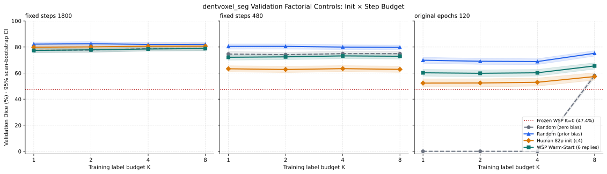
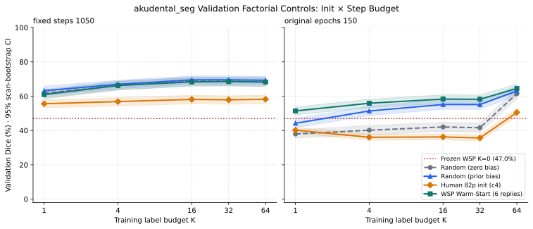

# Unified 3-Modality Results & Discussion (`dental-wsp`)

> **TL;DR:** We benchmarked Weight-Space Programming (WSP) — where blind large language models (LLMs) directly output all weights of compact neural networks without seeing training images — across six dental imaging tasks spanning 2D panoramic (AKUDENTAL), 2D periapical (DenPAR), and 3D cone-beam CT (CBCT; DentVoxel) data using 82-parameter segmenters and 261-parameter classifiers. On sealed held-out test splits, frozen zero-shot WSP achieves 42.4–46.6% mean Dice across 6 replies on tooth segmentation and `0.868 ± 0.059` ROC-AUC on axial maxillary-sinus classification in HU-windowed CBCT slices, where validation baselines confirm it clearly beats a 3-feature global-intensity logistic regression trained on all 60 scans (`0.870` vs. `0.719` Full / `0.854` vs. `0.611` Margin AUC). However, all other major claims fail or invert under fair controls: frozen 2D/3D segmentation is beaten on DenPAR by all-foreground (`53.9%` vs. `43.3%` val Dice) and a single train-selected threshold (`63.6%`), and on DentVoxel by a single HU-window threshold (`51.2%` vs. `47.4%` val Dice); `akudental_cls` stays at chance for every arm (`n = 16` test negatives); and frozen `denpar_cls` averages `0.467 ± 0.217` test AUC with 3/3 `opus` sign flips while a zero-parameter top-vs-bottom brightness rule reaches `0.880` validation AUC. Most importantly, **the v0.1.0 low-`K` WSP warm-start advantages on both `dentvoxel_seg` and `akudental_seg` do not survive fair fixed-step and log-odds prior-bias controls on validation**: simply initializing `output_bias = log(p/(1-p))` eliminates 100% of 3D random-init collapses (`0/60` collapsed runs) and beats all-6 WSP warm-start at every budget (`K = 1..8`) on `dentvoxel_seg` (`82.2%` vs. `77.4%` at `K = 1, S = 1,800`) and every budget (`K = 1..64`) on `akudental_seg` (`63.2–69.5%` vs. `60.9–68.5%` at `S = 1,050`). All deviations from the initial protocol are logged in [`docs/DEVIATIONS.md`](DEVIATIONS.md).

**Context & Non-Clinical Disclaimer:** Standard supervised deep tooth segmentation models (e.g., U-Net / nnU-Net) routinely exceed **90% Dice**. The 82-parameter and 261-parameter models evaluated here are **mechanistic research probes**, not competitors to supervised models and not suitable for clinical or diagnostic use.

> **Governance, Provenance & Deviations:** All 6 validation suites and 6 held-out test suites were run across 36 hash-unique, blind manual WSP replies logged in collection order across two LLM families (`astra_1..3`, `opus_1..3`; `n = 3` per family; **all 6 valid replies reported without post-hoc reply selection**).
> - **LLM family provenance:** `astra` = **GPT Astra-6.2 Max**; `opus` = **Opus 5.5 Max** (manual web-chat replies collected `2026-11-20`, ingested into repo locks `2026-11-24`–`2026-11-25`; `dentvoxel_seg` `astra_3` re-collected `2026-11-26T09:50:30Z`).
> - **Held-out test authorization & execution:** Governed by an internal Git-tracked receipt ([`docs/test_authorization.json`](test_authorization.json), first committed `2026-11-27` in `33ca670`, not an external registry such as OSF), executed via [`notebooks/04_sealed_test_evaluation.ipynb`](../notebooks/04_sealed_test_evaluation.ipynb) using code through `34a6b16` (after one mid-load crash on RGBA test mask `DenPAR Testing/431.png` was fixed), and sealed at `2026-11-27T11:06:39+00:00`. All 12 aggregate held-out test CSVs under [`results/sealed_test/`](../results/sealed_test/) are preserved unchanged with SHA-256 checksums verified by CI. See [`docs/DEVIATIONS.md`](DEVIATIONS.md) for the complete programmatic diff of locked vs. executed parameters and commit timeline.

**Abbreviations (defined on first use):** **WSP** (Weight-Space Programming), **CBCT** (cone-beam computed tomography), **HU** (Hounsfield Units; note CBCT gray values are not reliably calibrated HU), **FDI** (Fédération Dentaire Internationale tooth numbering), **ROI** (reference tooth enclosing bounding box), **FP** (false positive), **pp** (percentage points), **SD** (standard deviation), **CI** (confidence interval), **BF1** (Boundary F1 at 2-pixel tolerance in 2D / 3D Surface F1 at 2-voxel tolerance in 3D), **Edge Rec** (Reference-Edge / 3D Surface Recall within 2-pixel / 2-voxel tolerance), **IoU** (Intersection over Union), **RAS+** (Right–Anterior–Superior canonical NIfTI orientation), **LPS / LIP** (raw non-canonical NIfTI orientations), **ROC-AUC / PR-AUC** (Area Under the ROC / Precision-Recall Curve), **Margin-Crop** (border-zeroing ablation zeroing the outer 10% border of `64 × 64` inputs), **sign flip** (inverted score polarity flagged when ROC-AUC `< 0.35`, without flipping predictions), **`K_max`** (largest training label budget evaluated for a task — `200` of `650` training images for `denpar_seg`), **CEJ** (cementoenamel junction).

---

## 1. Cross-Modality Overview (`2 × 3` Matrix · Means ± SD Across All 6 Replies)

All headline numbers below report **means ± SD across all 6 locked replies** (`astra_1..3`, `opus_1..3`). Individual per-reply scores appear unbolded in Section 3.1.

### Table 1 · Track 2 Segmentation (Exact 82-Parameter Parity · Validation → Held-Out Test)

| Modality & Task (`val` / `test`, `K_max / train`) | Arch (Params) | Frozen WSP `K = 0` Dice *(Val → Test, 6 replies)* | Frozen Grid Gain `A − B` *(Test)* | Frozen Swap Loss A *(Test)* | Outside-ROI Share of Grid-Removed FPs (A vs B)\* *(Test)* | Frozen Box IoU A / Excl. Tooth† *(Test)* | Trained Pos-Only `K_max` *(Val → Test)* | Low-`K` Warm-Start vs. Random-Init *(Test, epoch schedule‡)* | `K_max` Warm-Start vs. Random-Init *(Test)* |
|---|---|---:|---:|---:|---:|---:|---|---|---|
| **AKUDENTAL** 2D Panoramic (`67` / `66`, `K_max = 200/200`) | `pano-wsp82-v1` (82) | 46.98% → **46.58 ± 5.45%** | +26.57 ± 6.84 pp | 16.64 ± 1.81 pp (`66/66`) | 90.27 ± 3.19% | 38.94% / 2.14% | 59.56% → 56.64 ± 1.92% *(Edge Rec 5.12%)* | `K = 2..32`: 50.9–57.3% vs. 34.6–46.3% *(+11.0 to +16.3 pp Dice)* | 66.27 ± 2.63% vs. 66.69 ± 0.93% |
| **DenPAR** 2D Periapical (`150` / `200`, **`K_max = 200/650`**) | `periapical-wsp82-v1` (82) | 43.35% → **42.35 ± 7.38%** | +0.88 ± 0.51 pp | 10.36 ± 1.92 pp (`166/200`) | 80.23 ± 25.58%\* | 69.33% / 0.22%† | 65.37% → 66.76 ± 2.54% *(Edge Rec 4.66%)* | `K = 1..64`: Warm 53.2–72.6% vs. Random 51.6–73.8% *(tied/slightly lower Dice)* | 73.54 ± 2.28% vs. 75.14 ± 1.27% |
| **DentVoxel** 3D CBCT (`20` / `20` scans, RAS+, `K_max = 60/60`) | `cbct-wsp82-v1` (82) | 47.42% → **45.54 ± 3.13%** | +10.95 ± 1.72 pp | 26.35 ± 2.79 pp | 90.20 ± 4.09% | 18.37% / 0.00%† | 7.32% → 7.12 ± 0.76% *(fails in 3D)* | `K = 1..4`: 56.9–57.5% vs. 0.00% Random collapse‡ | 78.87 ± 4.79% vs. 75.83 ± 12.79% *(n.s., 3 seeds)* |

*\* **Definition:** **Outside-ROI share of grid-removed FPs (A vs B)** = `100 × (outside-ROI FPs removed by the spatial grid) / (total net FPs removed by the grid)` comparing intact arm A vs. image-only arm B (`100 × fp_saved_out / (fp_saved_out + fp_saved_in)` when net FPs removed > 0). Because inside-ROI FPs can increase when the spatial grid is added (`fp_saved_in < 0`), this signed share can exceed `100%` (e.g., DenPAR `astra_2` = `128.99%`) or become negative. It is NOT a percentage reduction of total outside-ROI FPs.*
*† **Box-volume caveat:** Near-0% excluded tooth pixels/voxels is near-trivial when the predicted enclosing box spans most of the image/volume. On validation, frozen WSP enclosing boxes retain **99.37%** of the valid frame on DenPAR, **67.84%** on AKUDENTAL, and **59.52%** of the valid 3D CBCT volume on DentVoxel (`Box IoU = 15.7–22.5%` on test).*
*‡ **Falsified by v0.1.1 fixed-step & prior-bias controls (Section 4.2):** Under the v0.1.0 epoch schedule (`120` epochs, `batch_size = 4`, `output_bias = 0.0`), `dentvoxel_seg` `K = 1..4` received only `120` steps (vs. `1,800` at `K = 60`) under `<2%` foreground prevalence, and `akudental_seg` `K = 1..32` received only `150` steps (vs. `1,050` at `K = 200`). When controlled with log-odds prior bias and equal step budgets on validation, `random_prior_bias` eliminates 100% of collapses and **outperforms** all-6 WSP warm-start at every `K` on both `dentvoxel_seg` and `akudental_seg`.*

### Table 2 · Track 1 Classification (`cls-lenet2d-v1`, 261 Params · Held-Out Test with Hanley–McNeil 95% CIs)

| Modality & Task (`test` cohort, `n_pos / n_neg`) | Target | Frozen WSP `K = 0` Full AUC *(Val → Test ± SD; HM 95% CI; Flips)* | Frozen WSP `K = 0` Margin-Crop AUC *(Val → Test ± SD; HM 95% CI)* | Low-`K` Warm-Start (All 6) vs. Random-Init *(Test Full / Margin)* | `K_max` Warm-Start (All 6) vs. Random-Init *(Test Full / Margin; HM 95% CI on Full)* |
|---|---|---|---|---|---|
| **AKUDENTAL** 2D Panoramic (`n = 66`, `50 / 16`) | Restoration / implant presence | 0.511 → **0.543 ± 0.041** `[0.382–0.704]` *(0/6; 6/6 predict all-pos)* | 0.593 → **0.544 ± 0.141** `[0.383–0.704]` | All arms at chance (`0.46–0.55`; 95% CI ≈ `±0.16`) | **0.507 / 0.531** `[0.343–0.670]` vs. **0.470 / 0.419** `[0.305–0.635]` |
| **DenPAR** 2D Periapical (`n = 200`, `79 / 121`) | Upper vs. Lower arch *(orientation task)* | 0.428 → **0.467 ± 0.217** `[0.386–0.548]` *(3/3 `opus` flips)* | 0.501 → **0.485 ± 0.219** `[0.403–0.567]` | `K = 2..128`: Warm **0.432–0.825 / 0.445–0.795** vs. Random **0.460–0.922 / 0.476–0.719** | **0.810 / 0.793** `[0.746–0.875]` *(25/240 dead-ReLU)* vs. **0.977 / 0.812** `[0.953–1.000]` |
| **DentVoxel** 3D CBCT Axial (`20` scans, `1,720` slices, `512 / 1,208`)§ | Bilateral maxillary sinus presence | 0.870 → **0.868 ± 0.059** `[0.847–0.889]` *(0/6 flips)* | 0.854 → **0.864 ± 0.077** `[0.842–0.885]` | `K = 2` scans *(~170 slices)*: **0.982 / 0.971** `[0.973–0.990]` vs. Random **0.900 / 0.857** `[0.882–0.919]` | **0.991 / 0.981** `[0.985–0.997]` vs. **0.965 / 0.917** `[0.953–0.976]` |

*§ **Effective sample size warning (`dentvoxel_cls`):** The `1,720` held-out test slices are sampled at stride 4 from only **20 independent CBCT scans** (`effective n ≈ 20` scans, not `1,720` independent images). Slice-level Hanley–McNeil 95% CIs treat slices as independent and therefore substantially understate true scan-level uncertainty.*

---

## 2. Negative and Mixed Results

Stating the negative, null, and confounded findings plainly:

1. **Frozen 2D WSP segmentation does not beat trained position-only priors or simple intensity baselines:**
   - On **DenPAR** held-out test, frozen WSP (`42.35 ± 7.38%` Dice) is **22.1 pp below** `K = 1` trained position-only (`64.48 ± 0.69%`) and **24.4 pp below** `K_max = 200` trained position-only (`66.76 ± 2.54%`). On DenPAR validation (Section 4.1), simply predicting **all valid pixels as foreground** achieves `53.90%` Dice, zero-label **per-image Otsu** matches frozen WSP on Dice (`43.58%` vs. `43.35 ± 7.11%`) while outperforming it on BF1 (`22.06%` vs. `12.41%`) and Edge Rec (`30.47%` vs. `16.43%`), and a **single train-selected global threshold (`t* = 0.25`)** achieves `63.61%` Dice / `33.12%` BF1 / `43.78%` Edge Rec.
   - On **AKUDENTAL** held-out test, frozen WSP (`46.58 ± 5.45%` Dice) merely matches `K = 1` trained position-only (`45.98 ± 10.84%`) and `K = 32` random-init (`45.32 ± 3.69%`, ≈1.3 pp difference), and trails `K_max = 200` trained position-only (`56.64 ± 1.92%`, though position-only has poor boundary alignment: `5.12%` Edge Rec vs. `33.06%` frozen WSP).
2. **`K_max` warm-starting provides no consistent advantage over random initialization:**
   - On both 2D segmentation tasks at `K_max`, random-init is slightly higher than all-6 WSP warm-start (`akudental_seg`: `66.69 ± 0.93%` vs. `66.27 ± 2.63%`; `denpar_seg` at `K_max = 200/650`: `75.14 ± 1.27%` vs. `73.54 ± 2.28%`).
   - On 3D `dentvoxel_seg` (`K_max = 60`), all-6 warm-start (`78.87 ± 4.79%`) vs. random-init (`75.83 ± 12.79%`, where random seeds 0–2 scored `83.04%`, `83.38%`, and `61.06%`) is **not statistically significant** with only 3 random seeds.
3. **`akudental_cls` is at chance across all arms and underpowered:**
   - The held-out test split has only `16` negatives (`50` positives, `n = 66`), giving a Hanley–McNeil 95% CI half-width of **`±0.16`** around chance AUC (`0.50`).
   - All arms remain indistinguishable from chance across budgets (`0.419–0.554`). Furthermore, **all 6/6 frozen WSP replies predict 100% all-positive** (`sensitivity = 1.00, specificity = 0.00, accuracy = 75.8%`, identical to the majority-class rate).
4. **`denpar_cls` fails overall as frozen WSP, trails random-init as all-6 warm-start, and is largely an image-orientation task:**
   - Frozen WSP averages `0.4670 ± 0.2172` Full AUC (`0.4852 ± 0.2192` Margin-Crop), with **3/3 `opus` replies sign-flipping** (`0.255–0.321`).
   - Across all 6 replies at `K_max = 650`, WSP warm-start (`0.8102 ± 0.2237` Full / `0.7929 ± 0.2145` Margin-Crop) is **worse on Full AUC and roughly tied on Margin-Crop** compared to random-init (`0.9765 ± 0.0183` Full / `0.8117 ± 0.1168` Margin-Crop), because `25/240` `opus_2`/`opus_3` warm-start runs suffer dead-ReLU collapse (`AUC = 0.5000`; left unfixed under the locked protocol, see [`docs/DEVIATIONS.md`](DEVIATIONS.md)).
   - Highlighting `warm_astra` (`0.974` Full / `0.966` Margin-Crop) alone is a **post-hoc family subset** (`n = 3` replies), not an all-replies prespecified comparison.
   - Upper vs. Lower periapical arch classification is primarily a coarse vertical **image-orientation** task: on DenPAR validation (Section 4.1), the zero-parameter rule `mean(top_half) - mean(bottom_half)` achieves **`0.880` Full / `0.888` Margin-Crop AUC** without any LLM weights or training labels (while the zero-parameter rectified sharp-edge rule gets `0.263` / `0.220`, reproducing the exact sign-flip behavior observed in `opus_1..3`).
5. **LLM family (`astra` vs. `opus`) differences are small-sample (`n = 3`) and change direction across tasks:**
   - `astra` has higher frozen mean on `denpar_seg` (`49.03%` vs. `35.66%`), `akudental_seg` (`48.35%` vs. `44.81%`), and `denpar_cls` (`0.654` vs. `0.280`), whereas `opus` has higher frozen mean on `dentvoxel_seg` (`47.12%` vs. `43.97%`) and higher warm-start `K_max` on segmentation (`akudental_seg`, `denpar_seg`, `dentvoxel_seg`). With `n = 3` replies per family, no general family ranking can be concluded.
6. **Low-`K` segmentation warm-start advantages do NOT survive fair step-budget & prior-bias controls:**
   - On `dentvoxel_seg` validation (540 runs; Section 4.2), initializing random init with log-odds prior bias (`output_bias = log(p/(1-p))`) eliminates **100% of collapses (`0/60`)** and beats all-6 WSP warm-start at every budget (`K = 1, 2, 4, 8`) under **all three schedules** — including the original 120 epochs (`69.86%` vs. `60.22%` at `K = 1`, `−9.64 pp`), `S = 480` (`80.49%` vs. `72.11%`, `−8.37 pp`), and `S = 1,800` (`82.19%` vs. `77.36%`, `−4.83 pp`, 5/5 seeds negative). At `S = 1,800`, even the 1-active-filter `human_init` (`79.85–80.67%`) beats all-6 WSP warm-start (`77.36–78.81%`).
   - On `akudental_seg` validation (450 runs; Section 4.2), matching optimizer steps (`S = 1,050`) eliminates the entire `+11–16 pp` epoch-schedule warm-start lead: `random_prior_bias` (`63.18–69.55%` Dice, `44.0–51.2%` BF1, `46.1–59.2%` Edge Rec) beats all-6 WSP warm-start (`60.95–68.54%` Dice, `38.3–45.3%` BF1, `38.6–48.7%` Edge Rec) at **all 5 budgets (`K = 1, 4, 16, 32, 64`)**.
7. **Near-0% excluded tooth pixels/voxels reflects oversized bounding boxes:**
   - Validation audits confirm frozen WSP predicted boxes retain **99.37%** of the valid frame on DenPAR, **67.84%** on AKUDENTAL, and **59.52%** of the valid 3D volume on DentVoxel (`3D Box IoU = 15.7–22.5%` on test), making near-0% excluded tooth voxels near-trivial.

---

## 3. Held-Out Test Breakdown (`results/sealed_test/`)

All 12 aggregate CSVs under [`results/sealed_test/`](../results/sealed_test/) are preserved unchanged from the `2026-11-27T11:06:39Z` sealed run.

### 3.1 Stage 1 Frozen WSP (`K = 0`, All 6 Replies in Collection Order)

#### Track 2 Segmentation (`K = 0` · Intact Dice / Image-Only Dice / Swap Loss A / Outside-ROI Share of Grid-Removed FPs (A vs B) / Box IoU A / Excl. Tooth A)

| Reply | `akudental_seg` (`n = 66`) | `denpar_seg` (`n = 200`) | `dentvoxel_seg` (`20` scans, RAS+) |
|---|---|---|---|
| `astra_1` | 48.83% / 23.62% / 17.34 pp / 93.46% / 22.03% / 0.00% | 50.31% / 48.72% / 12.06 pp / 87.36% / 69.43% / 0.06% | 42.75% / 30.99% / 24.04 pp / 88.29% / 15.73% / 0.00% |
| `astra_2` | 48.13% / 23.76% / 17.71 pp / 94.48% / 23.12% / 0.00% | 47.78% / 46.36% / 11.84 pp / 128.99%\* / 69.42% / 0.14% | 44.92% / 32.63% / 24.78 pp / 87.67% / 18.94% / 0.00% |
| `astra_3` | 48.07% / 18.08% / 16.72 pp / 86.88% / 23.04% / 0.00% | 49.02% / 48.25% / 12.35 pp / 71.20% / 69.32% / 0.06% | 44.22% / 32.02% / 25.23 pp / 88.17% / 16.23% / 0.00% |
| `opus_1` | 42.37% / 16.32% / 14.19 pp / 87.22% / 66.86% / 9.27% | 35.77% / 35.41% / 8.93 pp / 61.80% / 69.47% / 0.53% | 43.44% / 35.48% / 24.89 pp / 95.02% / 18.99% / 0.00% |
| `opus_2` | 53.80% / 16.52% / 19.01 pp / 88.87% / 59.04% / 0.96% | 34.87% / 34.23% / 8.09 pp / 69.12% / 69.12% / 0.47% | 46.59% / 36.76% / 27.72 pp / 95.77% / 17.85% / 0.00% |
| `opus_3` | 38.26% / 21.74% / 14.88 pp / 90.72% / 39.54% / 2.60% | 36.34% / 35.85% / 8.91 pp / 62.93% / 69.20% / 0.05% | 51.34% / 39.67% / 31.44 pp / 86.30% / 22.51% / 0.00% |
| **Mean ± SD** | **46.58 ± 5.45%** / 20.01% / 16.64 pp / 90.27% / 38.94% / 2.14% | **42.35 ± 7.38%** / 41.47% / 10.36 pp / 80.23% / 69.33% / 0.22% | **45.54 ± 3.13%** / 34.59% / 26.35 pp / 90.20% / 18.37% / 0.00% |

*(Position-Only `K = 0` Dice = `0.00%` across all 18/18 frozen segmentation evaluations. \*DenPAR `astra_2` = `128.99%` because the spatial grid removed outside-ROI FPs while increasing inside-ROI FPs, making `fp_saved_out + fp_saved_in < fp_saved_out`.)*

#### Track 1 Classification (`K = 0` · Full ROC-AUC `[HM 95% CI]` → Margin-Crop ROC-AUC `[HM 95% CI]`)

| Reply | `akudental_cls` (`n = 66`, `50 pos / 16 neg`) | `denpar_cls` (`n = 200`, `79 pos / 121 neg`) | `dentvoxel_cls` (`20` scans / `1,720` slices, `512 / 1,208`)§ |
|---|---|---|---|
| `astra_1` | 0.528 `[0.366–0.689]` → 0.609 `[0.457–0.762]` | 0.777 `[0.709–0.846]` → 0.798 `[0.731–0.864]` | 0.847 `[0.825–0.869]` → 0.871 `[0.850–0.892]` *(Within-Scan 0.867)* |
| `astra_2` | 0.579 `[0.422–0.736]` → 0.539 `[0.378–0.700]` | 0.578 `[0.496–0.659]` → 0.683 `[0.606–0.760]` | 0.966 `[0.955–0.977]` → 0.949 `[0.935–0.962]` *(Within-Scan 0.976)* |
| `astra_3` | 0.601 `[0.447–0.755]` → 0.440 `[0.274–0.606]` | 0.608 `[0.527–0.689]` → 0.516 `[0.434–0.598]` | 0.811 `[0.787–0.836]` → 0.737 `[0.710–0.765]` *(Within-Scan 0.807)* |
| `opus_1` | 0.531 `[0.370–0.693]` → 0.439 `[0.273–0.604]` | 0.321 `[0.248–0.395]` → 0.363 `[0.287–0.440]` *(flip)* | 0.837 `[0.814–0.860]` → 0.924 `[0.907–0.940]` *(Within-Scan 0.853)* |
| `opus_2` | 0.488 `[0.323–0.652]` → 0.441 `[0.276–0.607]` | 0.264 `[0.196–0.332]` → 0.269 `[0.201–0.338]` *(flip)* | 0.833 `[0.810–0.856]` → 0.817 `[0.793–0.841]` *(Within-Scan 0.854)* |
| `opus_3` | 0.531 `[0.370–0.693]` → 0.794 `[0.682–0.906]` | 0.255 `[0.188–0.322]` → 0.282 `[0.212–0.352]` *(flip)* | 0.914 `[0.897–0.931]` → 0.883 `[0.863–0.903]` *(Within-Scan 0.920)* |
| **Mean ± SD** | **0.543 ± 0.041** `[0.382–0.704]` → **0.544 ± 0.141** `[0.383–0.704]` *(0 flips; all predict pos)* | **0.467 ± 0.217** `[0.386–0.548]` → **0.485 ± 0.219** `[0.403–0.567]` *(3 flips)* | **0.868 ± 0.059** `[0.847–0.889]` → **0.864 ± 0.077** `[0.842–0.885]` *(0 flips)* |

*§ Slice-level Hanley–McNeil CIs on `dentvoxel_cls` treat 1,720 slices as independent; effective `n ≈ 20` independent CBCT scans.*

### 3.2 Held-Out Test Learning Curves Summary (Stages 2 & 3 · Epoch-Based v0.1.0 Schedule)

- **`akudental_seg` (`66` test panoramics, `K_max = 200/200`):** Frozen WSP (`46.58 ± 5.45%` Dice, `33.06%` Edge Rec) matches random-init through `K = 32` (`45.32 ± 3.69%` Dice, `17.94%` Edge Rec). Under the v0.1.0 epoch schedule, all-6 WSP warm-start leads random-init by `+11.0 to +16.3 pp` across `K = 2..32` (`50.90–57.25%` vs. `34.59–46.28%`), converging slightly below random-init at `K_max = 200` (`66.27 ± 2.63%` vs. `66.69 ± 0.93%`; trained position-only `56.64 ± 1.92%` / `5.12%` Edge Rec).
- **`denpar_seg` (`200` test periapicals, `K_max = 200/650`):** Trained position-only reaches `64.48 ± 0.69%` at `K = 1` and `66.76 ± 2.54%` at `K_max = 200` (`4.66%` Edge Rec, `14.19%` excluded teeth). All-6 warm-start (`53.21% → 73.54 ± 2.28%`) slightly trails random-init (`51.63% → 75.14 ± 1.27%`) across `K = 2..200`, with similar or lower Edge Rec (`33.55%` vs. `38.39%` at `K_max = 200`).
- **`dentvoxel_seg` (`20` test CBCT scans, `K_max = 60/60`):** Trained position-only stays at `0.00%` through `K = 16` and reaches `7.12 ± 0.76%` at `K_max = 60`. Under the v0.1.0 epoch schedule (`120` epochs, `batch_size = 4`, `output_bias = 0.0`), random-init collapsed to `0.00%` on 3/3 seeds at `K = 1, 2, 4` (`120` steps) and 1/3 at `K = 8` (`240` steps; `47.89 ± 41.47%`), reaching `75.83 ± 12.79%` at `K_max = 60` (`83.04%`, `83.38%`, `61.06%`). All-6 warm-start had `0/126` zero-Dice runs, scoring `57.46 ± 4.84%` at `K = 1` and `78.87 ± 4.79%` at `K_max = 60` (not statistically significant vs. random-init with 3 seeds). See Section 4.2 for fair fixed-step and prior-bias validation controls.
- **`akudental_cls` (`66` test panoramics, `50/16`, `K_max = 200/200`):** Every arm stays near chance across all budgets (`K_max = 200`: warm-start `0.507 ± 0.075` `[0.343–0.670]` Full / `0.531 ± 0.091` `[0.369–0.692]` Margin vs. random-init `0.470 ± 0.093` `[0.305–0.635]` Full / `0.419 ± 0.029` `[0.253–0.584]` Margin).
- **`denpar_cls` (`200` test periapicals, `79/121`, `K_max = 650/650`):** At `K_max = 650`, random-init reaches `0.977 ± 0.018` `[0.953–1.000]` Full and `0.812 ± 0.117` `[0.748–0.876]` Margin-Crop (a `−0.165` border-zeroing drop). All-6 warm-start reaches `0.810 ± 0.224` `[0.746–0.875]` Full and `0.793 ± 0.214` `[0.726–0.860]` Margin-Crop (`25/240` dead-ReLU `opus_2`/`opus_3` runs). In a post-hoc family subset (`n = 3`), `warm_astra` scored `0.974` Full / `0.966` Margin-Crop (`0` dead runs).
- **`dentvoxel_cls` (`20` test scans, `1,720` slices, `512/1,208`, `K_max = 60/60`):** At `K = 2` scans (~170 labeled axial slices at stride 4), all-6 warm-start reaches `0.982 ± 0.010` `[0.973–0.990]` Full / `0.971 ± 0.027` `[0.960–0.981]` Margin-Crop vs. random-init `0.900 ± 0.049` `[0.882–0.919]` Full / `0.857 ± 0.032` `[0.835–0.878]` Margin-Crop. At `K_max = 60` scans, all-6 warm-start reaches `0.991 ± 0.004` `[0.985–0.997]` Full / `0.981 ± 0.016` `[0.972–0.989]` Margin-Crop vs. random-init `0.965 ± 0.027` `[0.953–0.976]` Full / `0.917 ± 0.051` `[0.900–0.934]` Margin-Crop (effective `n ≈ 20` scans).

### 3.3 Validation-to-Test Summary (Pre-Test Validation Reference)
- `akudental_seg` (`val = 67`): Frozen `46.98%` → test `46.58%`; `K_max = 200` warm `68.19%` / random `68.60%` / pos-only `59.56%` → test `66.27%` / `66.69%` / `56.64%`.
- `denpar_seg` (`val = 150`): Frozen `43.35%` → test `42.35%`; `K_max = 200/650` warm `71.97%` / random `73.65%` / pos-only `65.37%` → test `73.54%` / `75.14%` / `66.76%`.
- `dentvoxel_seg` (`val = 20` scans, RAS+): Frozen `47.42%` → test `45.54%`; `K_max = 60` warm `79.21%` / random `76.21%` / pos-only `7.32%` → test `78.87%` / `75.83%` / `7.12%`. *(Note: DentVoxel RAS+ canonicalization and `astra_3` replacement happened during validation auditing; see [`docs/DEVIATIONS.md`](DEVIATIONS.md).)*
- `akudental_cls` (`val = 67`): Frozen Full `0.511` / Margin `0.593` → test `0.543` / `0.544`.
- `denpar_cls` (`val = 150`): Frozen Full `0.428` / Margin `0.501` → test `0.467` / `0.485`.
- `dentvoxel_cls` (`val = 20` scans): Frozen Full `0.870` / Margin `0.854` → test `0.868` / `0.864`.

### 3.4 Sealed Test Artifact SHA-256 Receipts & Legacy Header Glossary

| Committed Artifact (`results/sealed_test/`) | SHA-256 Digest (Unchanged from v0.1.0) |
|---|---|
| `akudental_cls_test_stage1_frozen.csv` | `35e74c338147fab3380d4dbb3c3288815881ab8fe527b850e60890d8a5e8a68a` |
| `akudental_cls_test_summary.csv` | `442769f9333c0f446b0e321d2e582f391d7bff8d220c2b46daa73ac19ea95216` |
| `akudental_seg_test_stage1_frozen.csv` | `2b54726862804827ad6cae0849be4d7eb8ef8ed61f0d0ed6ae3b254c0888c35b` |
| `akudental_seg_test_summary.csv` | `4757b00a2cc5a97cd67378cec09aebba123cb9ca92961e59c09dd7bdcbdb478c` |
| `denpar_cls_test_stage1_frozen.csv` | `ab8b6135eeeb9e1baee2c41b71b9004f20b4000f877de90fe36563652afbb477` |
| `denpar_cls_test_summary.csv` | `bdfe4345610406549c9356d4dc0e37e4b0037e3a635e93c2ef6d10c06a9953b3` |
| `denpar_seg_test_stage1_frozen.csv` | `81d01ea55b952e61f56018cd4819c3a16662c98e262f6ef63825486e8cfc918b` |
| `denpar_seg_test_summary.csv` | `4f30835bdb02ad66be533e1b9ac876d2a6d5e8d9faee6c3024d4e7fdddf6722a` |
| `dentvoxel_cls_test_stage1_frozen.csv` | `a3b1dae18dffd51901073ca635e1dc434d3e3c019a12a42b3322b6a060dd1f9c` |
| `dentvoxel_cls_test_summary.csv` | `170a4c9532f591c11cbd970701545fb646518c4a6004bd347c56a6757b69c676` |
| `dentvoxel_seg_test_stage1_frozen.csv` | `4d3eeccd24fa1e92eb40b4f21e9e944ef3d9a9ad59950262bc60ad108bf12d80` |
| `dentvoxel_seg_test_summary.csv` | `a1eb20cd90c9afca118e0b37ce7f09e5a7916bfecdda6325fbd4a64c44bf6895` |

**Legacy Sealed-CSV Header Glossary:** Because `results/sealed_test/*.csv` are immutable after sealing, the segmentation Stage 1 CSVs retain the historical column name `Outside FP share (%)`. That column stores `outside_fp_reduction_share_pct` = **Outside-ROI share of grid-removed FPs (A vs B)** (`100 × fp_saved_out / (fp_saved_out + fp_saved_in)` when total net FPs removed > 0; can exceed `100%` if inside-ROI FPs increase, or be negative). New v0.1.1 CSV outputs use the explicit header `Outside-ROI share of grid-removed FPs (A vs B) (%)` and add `Predicted box valid fraction A (%)`.

---

## 4. Validation Controls & Non-LLM Baselines (v0.1.1 · Validation Split Only)

All v0.1.1 baseline and optimization-control experiments were executed **exclusively on `split == "train"` and `split == "val"`** (held-out test splits stay sealed). All 14 non-private aggregate CSVs and both SVG figures are archived under [`results/validation_controls/`](../results/validation_controls/).

### 4.1 Trivial & Non-LLM Baselines (`wsp_core/evaluation/baselines.py`)

#### Track 2 Segmentation Baselines (Validation Split · All 3 Modalities)

| Task (`n_val`) | `all_foreground` *(Dice / Box Valid %)* | `per_image_otsu` *(Dice / BF1 / Edge Rec)* | `global_train_threshold` *(t\* · Dice / BF1 / Edge Rec / Box Valid %)* | `human_82p_frozen` *(Dice / BF1 / Edge Rec)* | `human_82p_warmstart` *(`K=1` → `K_max`, 3 seeds)* | `frozen_wsp_mean6` *(Dice ± SD / BF1 / Edge Rec / Box Valid %)* | `trained_position_only` *(`K_max` val ref)* |
|---|---|---|---|---|---|---|---|
| **`denpar_seg`** (`150`) | **53.90%** / 100.0% | 43.58% / 22.06% / 30.47% | `t*=0.25`: **63.61%** / 33.12% / 43.78% / 100.0% | **63.61%** / 33.12% / 43.78% | 58.71% → 64.28 ± 0.14% *(Edge Rec 4.35%)* | 43.35 ± 7.11% / 12.41% / 16.43% / **99.37%** | 65.37% *(Edge Rec 4.70%)* |
| **`akudental_seg`** (`67`) | 17.34% / 100.0% | 24.21% / 22.57% / 42.05% | `t*=0.43`: 24.88% / 22.63% / 44.24% / 100.0% | 24.88% / 22.63% / 44.23% | 43.69% → 58.21 ± 0.03% *(Edge Rec 5.50%)* | **46.98 ± 6.12%** / 29.58% / 32.25% / **67.84%** | 59.56% *(Edge Rec 5.41%)* |
| **`dentvoxel_seg`** (`20` scans) | 2.00% / 100.0% | 3.31% / 6.52% / 33.55% | `t*=0.74` *(+1,960 HU-win)*: **51.18%** / 58.09% / 91.38% / 81.64% | **51.18%** / 58.09% / 91.37% | 52.51% → **80.96 ± 0.04%** *(Edge Rec 92.65%, Box 28.3%)* | 47.42 ± 3.19% / 51.60% / 96.08% / **59.52%** | 7.32% |

Key baseline findings (Track 2):
- **DenPAR:** Frozen WSP (`43.35%` Dice) loses to predicting **all valid pixels (`53.90%`)**, loses on BF1/Edge Rec to zero-label **Otsu** (`22.06% / 30.47%` vs. `12.41% / 16.43%`), and trails a single train-selected threshold (`63.61%`) by `20.3 pp`. Frozen WSP enclosing boxes retain `99.37%` of the valid frame.
- **DentVoxel:** A single HU-window threshold (`t* = 0.74`, `+1,960` on the `[-1000, +3000]` window; `human_82p_frozen`) reaches **`51.18%` Val Dice / `58.09%` Surface F1**, exceeding blind frozen WSP (`47.42 ± 3.19%` / `51.60%`) — though `t*` uses 60 training scans whereas frozen WSP is blind zero-shot and trims the enclosing-box valid fraction from `81.64%` to `59.52%`. Warm-started `human_82p_warmstart` (with only 1 active filter + `3 × 3 × 3` grid) reaches `80.96 ± 0.04%` at `K = 60` (`box_valid_vol = 28.31%`), outperforming all-6 `wsp_warmstart` (`79.21%`).
- **AKUDENTAL:** Intensity thresholding alone gets only `24.88%` Dice because bone, spine, and jaws share panoramic tooth intensities. Frozen WSP's `46.98 ± 6.12%` Dice comes from its hand-authored `3 × 5` panoramic arch grid (without the grid, frozen WSP image-only Dice is `21.13%` val / `20.01%` test — below global thresholding `24.88%`). Note also that `human_82p_warmstart` stalls near `trained_position_only` on 2D (`58.21%` on AKUDENTAL, `64.28%` on DenPAR, Edge Rec `4.3–5.5%`) because its filters 1–5 are initialized to exact zero with ReLU (zero gradient) and a single center-tap intensity filter cannot separate overlapping 2D anatomy.

#### Track 1 Classification Baselines (Validation Split · All 3 Modalities)

| Task (`n_val`, val prevalence) | `constant_score` *(Full / Margin / PR)* | `global_intensity_logreg` `K = 2` *(Full / Margin)* | `global_intensity_logreg` `K_max` *(Full / Margin / PR)* | Zero-Parameter Hand-Coded Rules (`denpar_cls`) | `frozen_wsp_mean6` *(Full / Margin / PR)* |
|---|---|---|---|---|---|
| **`akudental_cls`** (`67`, `0.761`) | 0.500 / 0.500 / 0.761 | 0.558 ± 0.079 / 0.558 ± 0.075 | 0.570 / 0.596 / 0.805 *(peak `K=32`: 0.601 / 0.618)* | — | 0.511 ± 0.067 / 0.593 ± 0.166 / 0.774 |
| **`denpar_cls`** (`150`, `0.353`) | 0.500 / 0.500 / 0.353 | 0.587 ± 0.062 / 0.618 ± 0.063 | 0.638 / 0.659 / 0.444 | Linear 5×5 edge: `0.643 / 0.450`; Rectified `r\|r\|`: `0.263 / 0.220` *(flip)*; **Top − Bottom half: `0.880 / 0.888`** *(82.7% acc)* | 0.428 ± 0.184 / 0.501 ± 0.241 / 0.324 |
| **`dentvoxel_cls`** (`20` scans, `0.317`) | 0.500 / 0.500 / 0.317 | 0.656 ± 0.064 / 0.645 ± 0.043 | 0.719 / 0.611 / 0.421 | — | **0.870 ± 0.057 / 0.854 ± 0.080 / 0.722** |

Key baseline findings (Track 1):
- **`dentvoxel_cls` is the single clearest surviving positive for frozen WSP:** Blind zero-shot frozen WSP (`0.870` Full / `0.854` Margin / `0.722` PR-AUC) exceeds the 3-feature global-intensity logistic regression even trained on all 60 scans (`0.719` / `0.611` / `0.421`) by `+0.151` Full AUC, `+0.243` Margin AUC, and `+0.301` PR-AUC, indicating spatial/morphological cavity filtering beyond global slice histograms (subject to `n = 20` scan sample size).
- **`denpar_cls` confirms trivial orientation structure & explains `opus` sign flips:** Zero-parameter `mean(top_half) - mean(bottom_half)` achieves `0.880` Full / `0.888` Margin AUC (beating all 6 frozen WSP replies), while the zero-parameter rectified sharp-edge rule `mean(r * |r|)` sign-flips (`0.263 / 0.220`), reproducing `opus_1..3`'s sign-flip mechanism.
- **`akudental_cls`:** 3-feature global-intensity logistic regression (`0.546–0.601` Full) beats frozen WSP (`0.511`) at all 7 budgets, confirming near-chance performance at `64 × 64`.

---

### 4.2 Fixed-Step & Prior-Bias Factorial Controls (`wsp_core/training/controls.py`)

Both factorials ran to completion with zero NaNs (`540` runs on `dentvoxel_seg`, `450` runs on `akudental_seg`), giving **all four init arms identical optimizer step budgets** in every schedule. Note that the 95% bootstrap CIs below resample validation scans/images (`B = 2,000`) while `SD` captures seed-to-seed (and reply-to-reply) variation across the 5 seeds.

#### Primary Factorial · `dentvoxel_seg` Validation (`20` CBCT scans, `K ∈ {1, 2, 4, 8}`, `seeds = 0..4`, 540 runs)

| Schedule | `K` | `random_zero_bias` *(Mean ± SD; 95% scan CI; Collapses)* | `random_prior_bias` *(Mean ± SD; 95% scan CI; Collapses)* | `human_init` *(Mean ± SD; 95% scan CI; Collapses)* | `wsp_warmstart` (all 6) *(Mean ± SD; 95% scan CI; Collapses)* | Paired `wsp − random_prior` *(Mean ± seed SD [min, max]; scan CI)* |
|---|---:|---|---|---|---|---|
| `original_epochs_120` | 1 | 0.00 ± 0.00% `[0.0–0.0]` (`5/5`) | **69.86 ± 1.67%** `[67.5–72.1]` (`0/5`) | 52.32 ± 0.68% `[49.4–55.5]` (`0/5`) | 60.22 ± 4.59% `[57.7–62.8]` (`0/30`) | **−9.64 ± 1.58 pp** `[-11.4, -8.2]` (`[-10.7, -8.5]`) |
| `original_epochs_120` | 2 | 0.00 ± 0.00% `[0.0–0.0]` (`5/5`) | **69.06 ± 3.12%** `[66.7–71.3]` (`0/5`) | 52.41 ± 0.59% `[49.4–55.6]` (`0/5`) | 59.83 ± 4.45% `[57.3–62.4]` (`0/30`) | **−9.24 ± 2.35 pp** `[-12.1, -5.8]` (`[-10.3, -8.2]`) |
| `original_epochs_120` | 4 | 0.00 ± 0.00% `[0.0–0.0]` (`5/5`) | **68.85 ± 2.51%** `[66.5–71.0]` (`0/5`) | 52.95 ± 0.77% `[50.0–56.1]` (`0/5`) | 60.22 ± 4.26% `[57.7–62.8]` (`0/30`) | **−8.63 ± 2.45 pp** `[-11.9, -5.6]` (`[-9.7, -7.5]`) |
| `original_epochs_120` | 8 | 58.12 ± 32.50% `[56.3–59.8]` (`1/5`) | **75.19 ± 3.14%** `[73.0–77.2]` (`0/5`) | 57.35 ± 0.43% `[54.6–60.3]` (`0/5`) | 65.49 ± 3.96% `[63.1–67.9]` (`0/30`) | **−9.70 ± 3.13 pp** `[-12.3, -4.5]` (`[-10.7, -8.7]`) |
| `fixed_steps_480` | 1 | 74.62 ± 8.18% `[72.5–76.5]` (`0/5`) | **80.49 ± 1.45%** `[78.4–82.4]` (`0/5`) | 63.29 ± 2.95% `[60.9–65.6]` (`0/5`) | 72.11 ± 6.01% `[69.9–74.1]` (`0/30`) | **−8.37 ± 1.70 pp** `[-11.2, -7.2]` (`[-8.8, -7.9]`) |
| `fixed_steps_480` | 2 | 74.12 ± 9.72% `[72.0–76.0]` (`0/5`) | **80.48 ± 1.06%** `[78.4–82.4]` (`0/5`) | 62.77 ± 1.48% `[60.4–65.2]` (`0/5`) | 72.46 ± 5.87% `[70.3–74.4]` (`0/30`) | **−8.02 ± 1.00 pp** `[-9.7, -7.3]` (`[-8.4, -7.6]`) |
| `fixed_steps_480` | 4 | 74.92 ± 8.76% `[72.9–76.7]` (`0/5`) | **79.96 ± 3.72%** `[78.1–81.7]` (`0/5`) | 63.39 ± 1.92% `[61.1–65.7]` (`0/5`) | 73.18 ± 5.70% `[71.1–75.0]` (`0/30`) | **−6.78 ± 3.46 pp** `[-9.0, -0.7]` (`[-7.3, -6.3]`) |
| `fixed_steps_480` | 8 | 74.87 ± 8.34% `[72.8–76.7]` (`0/5`) | **79.73 ± 3.67%** `[77.8–81.5]` (`0/5`) | 62.87 ± 1.04% `[60.5–65.3]` (`0/5`) | 72.91 ± 5.30% `[70.7–74.8]` (`0/30`) | **−6.83 ± 3.77 pp** `[-9.0, -0.1]` (`[-7.4, -6.3]`) |
| `fixed_steps_1800` | 1 | 77.48 ± 8.54% `[75.7–79.1]` (`0/5`) | **82.19 ± 1.18%** `[80.3–83.8]` (`0/5`) | 79.85 ± 1.78% `[77.9–81.8]` (`0/5`) | 77.36 ± 4.53% `[75.6–78.9]` (`0/30`) | **−4.83 ± 0.26 pp** `[-5.1, -4.5]` (`[-5.1, -4.6]`) |
| `fixed_steps_1800` | 2 | 77.65 ± 9.82% `[75.8–79.3]` (`0/5`) | **82.55 ± 0.80%** `[80.7–84.2]` (`0/5`) | 80.11 ± 0.91% `[78.1–82.0]` (`0/5`) | 77.84 ± 4.50% `[76.1–79.4]` (`0/30`) | **−4.71 ± 0.35 pp** `[-5.0, -4.1]` (`[-4.9, -4.5]`) |
| `fixed_steps_1800` | 4 | 78.78 ± 9.43% `[77.1–80.3]` (`0/5`) | **81.94 ± 3.81%** `[80.3–83.4]` (`0/5`) | 80.61 ± 0.32% `[78.7–82.5]` (`0/5`) | 78.47 ± 4.42% `[76.8–79.9]` (`0/30`) | **−3.46 ± 3.93 pp** `[-5.4, +3.6]` (`[-3.7, -3.2]`) |
| `fixed_steps_1800` | 8 | 78.95 ± 9.21% `[77.2–80.5]` (`0/5`) | **82.01 ± 3.84%** `[80.3–83.6]` (`0/5`) | 80.67 ± 0.35% `[78.7–82.6]` (`0/5`) | 78.81 ± 4.38% `[77.1–80.3]` (`0/30`) | **−3.19 ± 3.89 pp** `[-5.4, +3.7]` (`[-3.4, -3.0]`) |

*Per-family & seed detail at `S = 1,800` (`dentvoxel_seg`): `opus` warm-start reaches `81.38–82.76%` (comparable to `random_prior_bias` `81.94–82.55%`), while `astra` warm-start stalls at `73.34–74.86%`. Even without prior bias, `random_zero_bias` has `0/20` collapses at both `S = 480` and `S = 1,800`: four of five seeds reach `80.1–83.5%` at `S = 1,800`, while seed `2` lands in a `60.1–62.5%` local basin (matching seed `2`'s `61.06%` held-out test run at `K = 60` in v0.1.0), which prior-bias initialization resolves (`81.4–83.7%` on seed `2`).*

#### Secondary Factorial · `akudental_seg` Validation (`67` panoramics, `K ∈ {1, 4, 16, 32, 64}`, `seeds = 0..4`, 450 runs)

| Schedule | `K` | `random_zero_bias` *(Mean ± SD; 95% img CI)* | `random_prior_bias` *(Mean ± SD; 95% img CI)* | `human_init` *(Mean ± SD; 95% img CI)* | `wsp_warmstart` (all 6) *(Mean ± SD; 95% img CI)* | Paired `wsp − random_prior` *(Mean ± seed SD [min, max]; img CI)* |
|---|---:|---|---|---|---|---|
| `original_epochs_150` | 1 | 37.94 ± 14.80% `[35.6–40.3]` | 44.22 ± 8.87% `[41.6–47.0]` | 40.19 ± 10.41% `[38.5–41.8]` | **51.41 ± 11.50%** `[49.1–53.7]` | +7.20 ± 6.55 pp `[-1.0, +17.3]` (`[+6.2, +8.1]`) |
| `original_epochs_150` | 4 | 40.16 ± 7.04% `[37.5–42.9]` | 51.39 ± 4.83% `[48.7–54.1]` | 36.05 ± 6.38% `[34.3–37.8]` | **55.89 ± 9.82%** `[53.4–58.3]` | +4.50 ± 2.41 pp `[+2.2, +8.1]` (`[+3.7, +5.3]`) |
| `original_epochs_150` | 16 | 42.07 ± 6.22% `[39.4–44.8]` | 55.15 ± 2.16% `[52.4–57.9]` | 36.23 ± 2.06% `[34.5–38.0]` | **58.32 ± 8.45%** `[55.7–60.8]` | +3.16 ± 0.93 pp `[+1.8, +4.1]` (`[+2.3, +4.0]`) |
| `original_epochs_150` | 32 | 41.61 ± 5.98% `[38.9–44.4]` | 55.11 ± 1.33% `[52.3–57.9]` | 35.66 ± 1.18% `[33.9–37.4]` | **58.21 ± 8.98%** `[55.6–60.8]` | +3.10 ± 0.90 pp `[+2.0, +4.0]` (`[+2.2, +4.0]`) |
| `original_epochs_150` | 64 | 61.45 ± 1.25% `[58.6–64.2]` | 63.10 ± 0.45% `[60.4–65.6]` | 50.53 ± 0.27% `[48.2–52.6]` | **64.48 ± 3.45%** `[61.8–67.1]` | +1.38 ± 0.37 pp `[+0.9, +1.9]` (`[+0.9, +1.8]`) |
| `fixed_steps_1050` | 1 | 61.64 ± 3.70% `[59.2–64.0]` | **63.18 ± 2.78%** `[60.5–65.8]` | 55.60 ± 3.67% `[53.2–57.8]` | 60.95 ± 6.41% `[58.4–63.3]` | **−2.23 ± 3.76 pp** `[-8.8, +0.2]` (`[-2.6, -1.9]`) |
| `fixed_steps_1050` | 4 | 66.22 ± 0.92% `[63.6–68.7]` | **66.94 ± 0.79%** `[64.4–69.3]` | 56.85 ± 2.53% `[54.3–59.2]` | 66.24 ± 2.90% `[63.6–68.7]` | **−0.69 ± 0.87 pp** `[-1.8, +0.3]` (`[-0.9, -0.5]`) |
| `fixed_steps_1050` | 16 | 68.74 ± 1.07% `[66.2–71.1]` | **69.51 ± 0.85%** `[67.0–71.8]` | 58.12 ± 0.80% `[55.5–60.5]` | 68.33 ± 2.75% `[65.8–70.7]` | **−1.18 ± 0.85 pp** `[-2.3, -0.4]` (`[-1.4, -1.0]`) |
| `fixed_steps_1050` | 32 | 68.73 ± 1.56% `[66.1–71.1]` | **69.55 ± 0.76%** `[67.0–71.8]` | 57.89 ± 0.51% `[55.3–60.2]` | 68.54 ± 2.78% `[65.9–70.9]` | **−1.01 ± 0.43 pp** `[-1.4, -0.5]` (`[-1.3, -0.7]`) |
| `fixed_steps_1050` | 64 | 68.24 ± 1.10% `[65.6–70.7]` | **69.26 ± 0.52%** `[66.8–71.6]` | 58.20 ± 0.24% `[55.6–60.6]` | 68.23 ± 2.67% `[65.6–70.6]` | **−1.03 ± 0.62 pp** `[-1.8, -0.4]` (`[-1.4, -0.7]`) |

*(0/450 collapsed runs across all AKUDENTAL factorial cells. At `S = 1,050`, `random_prior_bias` also beats all-6 `wsp_warmstart` on BF1 (`44.0–51.2%` vs. `38.3–45.3%`) and Edge Recall (`46.1–59.2%` vs. `38.6–48.7%`) at every `K`.)*

**Honest Verdict on Low-`K` Warm-Start Claims:**
The low-`K` segmentation warm-start advantages reported in v0.1.0 **do not survive fair random-init controls**. Both the 3D CBCT collapse (`0.00%` Dice at `K = 1..4` on `dentvoxel_seg`) and the 2D panoramic low-`K` gap (`+11–16 pp` at `K = 2..32` on `akudental_seg`) were artifacts of under-training random initialization under fixed-epoch schedules (120–150 steps at low `K`) and initializing `output_bias = 0.0` under strong class imbalance (`~1%` foreground in 3D). Once random initialization receives the standard one-line log-odds prior bias (`log(p/(1-p))`) and matched optimizer steps, it has **zero collapses across all 110/110 runs** (`0/60` on DentVoxel, `0/50` on AKUDENTAL) and outperforms all-6 WSP warm-start at **every single low-`K` budget tested** on both `dentvoxel_seg` (`82.2%` vs. `77.4%` from `K = 1` scan at `S = 1,800`) and `akudental_seg` (`63.2%` vs. `60.9%` from `K = 1` film at `S = 1,050`, plus `+5.3–6.6 pp` higher BF1 and `+7.3–11.8 pp` higher Edge Recall).

---

## 5. Mechanistic Discussion & Limitations

1. **Intensity-Windowing Hypothesis (Confounded by Task, Prompt & Dataset):**
   In 2D radiographs normalized by per-film `0.5th–99.5th` percentiles, relative gray levels shift with exposure, sensor rims, and anatomy, and frozen WSP fails to beat trivial intensity or orientation baselines on DenPAR (`denpar_seg`, `denpar_cls`) or global intensity features on `akudental_cls`. On DentVoxel CBCT, inputs are mapped through a fixed dental intensity window (`[-1000, +3000] → [0, 1]`). **Importantly, CBCT gray values are not reliably calibrated Hounsfield Units.** While frozen WSP genuinely beats the 3-feature global-intensity logistic regression on `dentvoxel_cls` (`0.870` vs. `0.719` Full / `0.854` vs. `0.611` Margin AUC on validation), on `dentvoxel_seg` a single train-selected HU-window threshold (`51.18%`) already exceeds blind frozen WSP (`47.42%`). Any advantage of fixed intensity windowing remains **a hypothesis confounded by task structure (gross bilateral air-filled maxillary sinus cavities vs. subtle metallic restorations), prompt cues, 3D geometry, and dataset differences**.
2. **Spatial Prior Behavior Across Imaging Geometries:**
   - **Panoramic (`AKUDENTAL`):** Standardized jaw geometry makes the `3 × 5` spatial grid essential for frozen WSP (`+26.57 ± 6.84 pp` test `A − B` Dice gain; `46.98%` vs. `24.88%` global intensity thresholding on val), though `K_max = 200` trained position-only reaches `56.64%` test Dice (`5.12%` Edge Rec) and frozen WSP boxes still retain `67.84%` of the valid canvas.
   - **Periapical (`DenPAR`):** Removing standardized panoramic framing shrinks grid gain to `+0.88 ± 0.51 pp`, and frozen WSP (`42.35%` test / `43.35%` val Dice) loses to all-foreground (`53.90%` val), per-image Otsu (`43.58%` val Dice with `+9.7 pp` higher BF1 and `+14.0 pp` higher Edge Rec), and a single global threshold (`63.61%` val Dice).
   - **3D CBCT (`DentVoxel`):** Volumetric tooth sparsity (`~1%` of valid voxels; all-foreground Dice = `2.00%`) breaks the pure spatial shortcut (`Trained Position-Only` drops to `7.12%` test Dice). The `3 × 3 × 3` grid adds `+10.95 ± 1.72 pp` test Dice and shrinks enclosing-box valid-volume retention from `81.64%` (global threshold) to `59.52%` (frozen WSP val), yet retaining nearly 60% of the valid 3D volume (`3D Box IoU = 15.7–22.5%` on test) still makes `0.00%` excluded tooth voxels near-trivial.
3. **Optimization Confounds Resolved & Dead-ReLU Risk:**
   - **Resolved low-`K` confound:** The v0.1.1 validation factorials (Section 4.2) demonstrate conclusively that v0.1.0's sparse-3D random-init collapse and 2D low-`K` warm-start gaps were artifacts of epoch-based step scaling and `output_bias = 0.0`, not a genuine warm-start advantage of LLM-generated weights.
   - **Dead-ReLU risk:** Negative hand-coded `conv1_bias`/`conv2_bias` in `denpar_cls` `opus_2..3` produced `25/240` dead-ReLU runs (`AUC = 0.5000`), and zero-initialized filters `1–5` in `human_82p_warmstart` remained inactive under ReLU on 2D tasks — demonstrating how brittle hand-coded initializations can impede gradient fine-tuning compared to properly bias-calibrated random initialization.
4. **Coordinate-Frame Fidelity (`DentVoxel` RAS+ Audit):**
   Pre-test validation auditing uncovered `99 LPS + 1 LIP` raw NIfTI orientations and 5 skipped scan IDs (`img0001..0105`). Enforcing NIfTI `sform`/`qform` RAS+ canonicalization in commit `05ae8d2` resolved the prompt-vs-volume `Y`-axis flip, but because this fix occurred after observing validation scores, the DentVoxel validation split partly acted as a development set (disclosed in [`docs/DEVIATIONS.md`](DEVIATIONS.md)).
5. **Scope Limitation on DenPAR (Tooth Union vs. Clinical Landmarking):**
   Although DenPAR also distributes CEJ/root-apex keypoints and bone-level annotations, `dental-wsp` evaluated tooth-union segmentation and Upper vs. Lower arch classification to maintain exact 82p/261p architectural parity across modalities and to remain strictly non-clinical (sub-millimeter CEJ/crestal bone-loss staging is beyond the capacity and scope of 82-parameter mechanistic probes).
